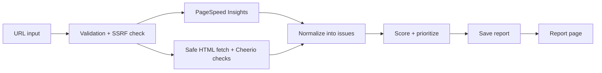

# Loupe

**A free website health check for small business owners, in plain language.**

Type in a website address and get a clear report in about 30 seconds: what's wrong, why it matters for the business, how to fix it, and what to do first. No signup, no jargon.

**Live demo:** _coming soon_ · **Example report:** `/en/report/example`

Available in English, French and Arabic (full right-to-left layout).

---

## The problem

Most website audit tools are built for developers. They show a score of 47, a list of terms like "LCP" and "render-blocking resources", and leave a café or dental clinic owner with no idea what to do next.

Loupe turns the same technical checks into a report the owner can act on, while keeping the technical detail one click away for whoever does the fixing.

## What it does

- **Letter grade and scores.** One overall grade (A to F) plus a score for each area: speed, search visibility, accessibility and technical health.
- **"Fix these first."** The three problems that matter most and take the least effort, at the top of every report.
- **Plain-language explanations.** Each issue says what's wrong, why it matters for the business ("visitors leave before your page loads"), and how to fix it.
- **Steps for your platform.** Detects WordPress, Wix, Shopify, Squarespace and Webflow, and gives fix steps for that platform's own menus.
- **"Send to my developer."** Turns the report into a technical to-do message the owner can paste into an email, with code examples and raw values.
- **Re-scan and compare.** After fixing things, run it again and see what improved, what's fixed and what's still open.
- **Local business checks (optional).** Phone number, address, opening hours and map link, for businesses that serve local customers.
- **Shareable reports.** Every report gets a private link that expires after 30 days.
- **Free guides.** A how-to page for every problem the tool checks, written for non-technical readers.

## What it checks

43 automated checks on the homepage, plus its `robots.txt` and `sitemap.xml`:

| Area | Examples |
|---|---|
| Speed (mobile) | Load time, layout jumps, heavy images, slow scripts, using Google PageSpeed Insights |
| Search visibility | Page title, description, headings, link previews on social media, pages hidden from Google |
| Accessibility | Image descriptions, labelled form fields, empty links and buttons, page language |
| Technical | HTTPS, redirects, broken status, mixed content, security settings, favicon, sitemap |
| Local business | Business details for Google, tap-to-call phone link, address, opening hours, map |

It audits one page, and it says so. These are automated checks, not a full manual audit, and the report never claims more certainty than it has.

---

## For developers

### Tech stack

- **Next.js 16** (App Router, Cache Components), **React 19**, **TypeScript** in strict mode
- **Tailwind CSS 4** and **shadcn/ui**, with logical (RTL-safe) utilities throughout
- **Zod** to validate every input, external response and stored report
- **Cheerio** for HTML analysis
- **Google PageSpeed Insights API** (mobile)
- **Upstash Redis** for report storage, caching and rate limiting
- **next-intl** for English, French and Arabic
- **Vitest**: 474 tests

### How it works



The two sources run in parallel. If one fails (for example, the speed test times out), the user still gets a report with what succeeded and a clear note about what's missing.

Progress is streamed to the browser as it happens ("Testing mobile speed…", "Checking SEO…"), so the loading screen shows real stages, not a fake spinner.

### Design decisions

**Security first.** The server fetches addresses that users type in, which is a classic attack route (server-side request forgery). Every request is checked:
- only `http` and `https`, no credentials in the URL, no unusual ports
- every resolved IP is checked against private and internal ranges (IPv4 and IPv6, including cloud metadata addresses and disguised forms like hex or decimal IPs)
- redirects are followed by hand, at most 5, and each hop is checked again
- the connection is pinned to the IP that was checked, to block DNS-rebinding tricks
- 10-second timeout, 2 MB size cap, HTML only

**Checks are pure functions.** Each check takes a page snapshot and returns a list of issues, with no network or database access. That makes them fast to test and easy to move into a background worker later.

**Content is separate from logic.** Checks return only an issue id and raw evidence. All the wording lives in a knowledge base, one file per language, joined to the report when it's displayed. So one stored report can be read in any language instantly, without running the audit again.

**Two layers in one report.** The owner sees plain language by default. A "Technical view" switch opens the developer details on every issue: code snippets, raw values and Core Web Vitals.

**Tests enforce the rules.** Besides the usual unit tests, automated tests make sure that:
- every check has an explanation in all three languages
- banned jargon (LCP, CSP, canonical…) never appears in the plain-language text
- every interface text exists in all three languages
- no unsafe HTML rendering slips into the code

**Honest scoring.** Each area starts at 100 and loses points per problem found (more for serious ones). Speed uses Google's own score. The overall score is a weighted average, shown as whole numbers only, with no false precision.

**Abuse protection.** Rate limit per visitor (5 audits per hour), a daily cap on speed tests to protect the API quota, a 1-hour cache for repeat audits, and strict security headers on the app itself.

**It follows its own advice.** Static pages, structured data, hreflang for all three languages, translated social preview images, a sitemap, keyboard navigation and visible focus states.

### Run it locally

```bash
npm install
cp .env.example .env.local   # then fill in your keys
npm run dev
```

You need a Google PageSpeed Insights API key and a free Upstash Redis database. See `.env.example` for every setting.

```bash
npm test           # unit tests
npm run typecheck  # TypeScript
npm run lint       # ESLint
```

### Limitations

- One page per audit (the homepage), plus `robots.txt` and `sitemap.xml`. No crawling.
- Mobile speed test only.
- Sites built entirely with JavaScript can't be fully read without a browser. The report flags this instead of guessing.
- French and Arabic text is still waiting for a review by native speakers.

---

Built by **Bilel Jabrane**.
